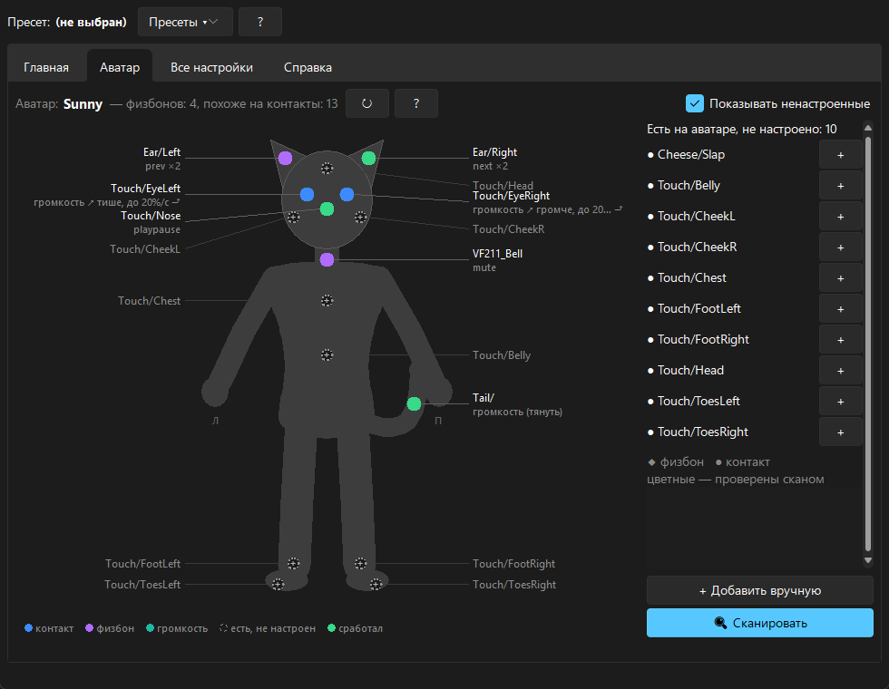

# VRChat OSC

Управление музыкой, громкостью и звуками через аватар в VRChat: тронул нос — пауза, потянул за ухо — следующий трек, потянул хвост — громкость. Плюс трек, прогресс и текст песни в чатбоксе.

## Скачать

**[⬇ Последняя версия](https://github.com/Danila239/VRChatOSC-app/releases/latest)** — файл `VRChatOSC.exe`.

Установка не нужна: положи exe в отдельную папку (рядом с ним программа хранит настройки) и запусти.

> Windows может показать «Система Windows защитила ваш компьютер» — exe не подписан платным сертификатом. Нажми «Подробнее» → «Выполнить в любом случае».

## Как получить доступ

1. Запусти `VRChatOSC.exe`.
2. В окне «Доступ» впиши свой ник (VRChat или Discord) и нажми **«Отправить запрос»**.
3. Подожди одобрения. Окно можно не закрывать — программа запустится сама, как только запрос одобрят. Если закрыл — ключ подтянется при следующем запуске.

Доступ привязан к компьютеру: на другом ПК (или после переустановки Windows) нужно отправить запрос заново.

## Что нужно

- Windows 10/11
- VRChat с включённым OSC (Action Menu → Options → OSC → Enabled)
- Для управления громкостью отдельной полосы — VoiceMeeter (необязательно)

## Обновления

Программа сама проверяет новые версии и показывает кнопку «Доступна версия X». Новую версию качай отсюда же, из [Releases](https://github.com/Danila239/VRChatOSC-app/releases), и заменяй старый exe — настройки и ключ сохранятся.

