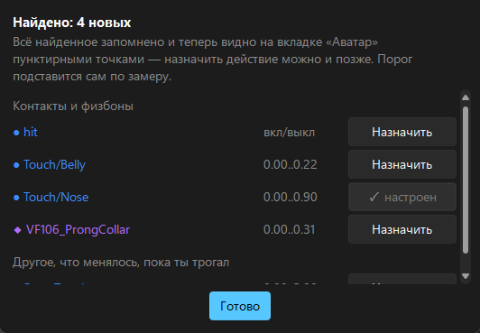

# VRChat OSC

Управление музыкой, громкостью и звуками через аватар в VRChat: тронул нос — пауза, потянул за ухо — следующий трек, потянул хвост — громкость. Плюс трек, прогресс и текст песни в чатбоксе.

## Скачать

**[⬇ Последняя версия](https://github.com/Danila239/VRChatOSC-app/releases/latest)** — файл `VRChatOSC.exe`.

Установка не нужна: положи exe в отдельную папку (рядом с ним программа хранит настройки) и запусти.

> Windows может показать «Система Windows защитила ваш компьютер» — exe не подписан платным сертификатом. Нажми «Подробнее» → «Выполнить в любом случае».

## Как получить доступ

1. Запусти `VRChatOSC.exe`.
2. В окне «Доступ» впиши свой ник (VRChat или Discord) и нажми **«Отправить запрос»**.
3. Подожди одобрения. Окно можно не закрывать — программа запустится сама, как только запрос одобрят. Если закрыл — ключ подтянется при следующем запуске.

Доступ привязан к компьютеру: на другом ПК (или после переустановки Windows) нужно отправить запрос заново.

## Первая настройка

При первом запуске откроется мастер настройки — 4 шага:

1. **Подключи VRChat** — включи OSC в игре, программа покажет «Связь есть».
2. **Найди контакты** — нажми «Найти контакты» и потрогай в игре то, чем хочешь управлять (нос, уши, хвост…), затем назначь действия: следующий трек, пауза, громкость.
3. **Громкость и текст над головой** — выбери физбон для громкости и включи показ трека в чатбоксе.
4. **Готово** — настройки сохранятся как пресет для твоего аватара.

Мастер можно открыть снова кнопкой «🧭 Мастер настройки» на главной вкладке.

## Что нужно

- Windows 10/11
- VRChat с включённым OSC (Action Menu → Options → OSC → Enabled)
- Для управления громкостью отдельной полосы — VoiceMeeter (необязательно)

## Обновления

С версии 1.2.0 программа обновляется сама: когда выходит новая версия, справа сверху появляется кнопка **«Обновить до X»**. Нажми её — программа скачает новую версию, проверит её, перезапустится, и всё. Настройки, пресеты и доступ сохраняются.

Если у тебя версия старше 1.2.0 — один раз скачай новую из [Releases](https://github.com/Danila239/VRChatOSC-app/releases) и замени старый exe в той же папке.

